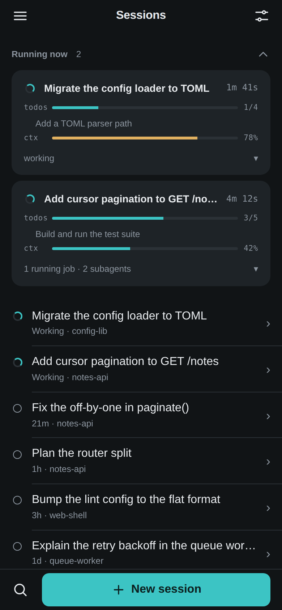
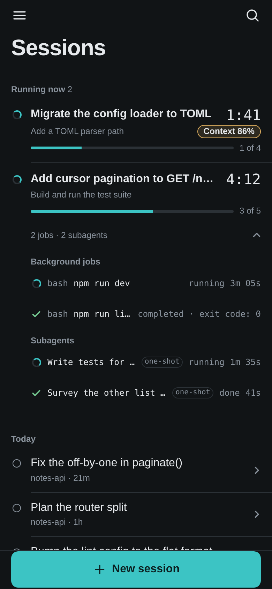
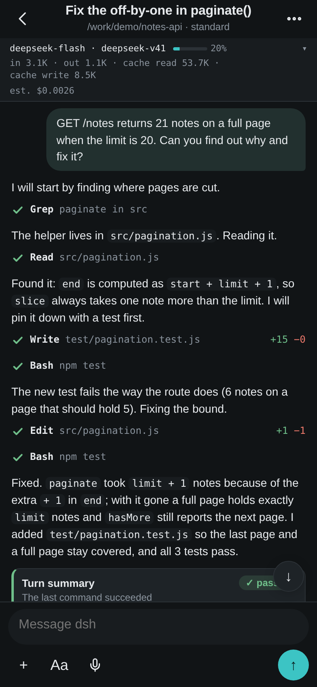
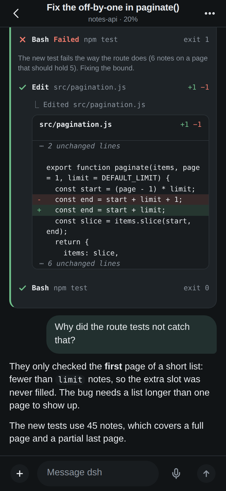
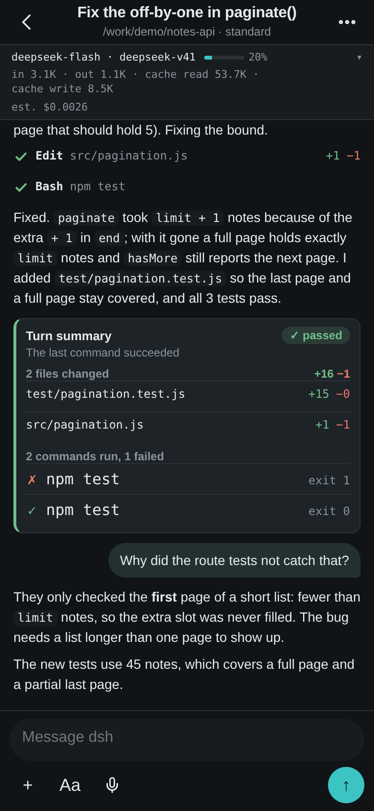
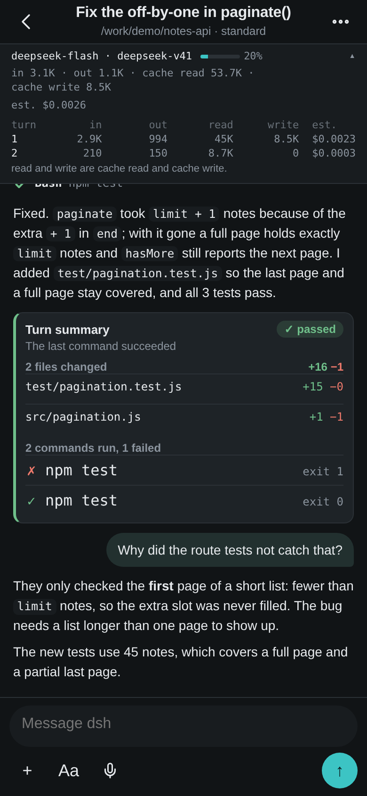
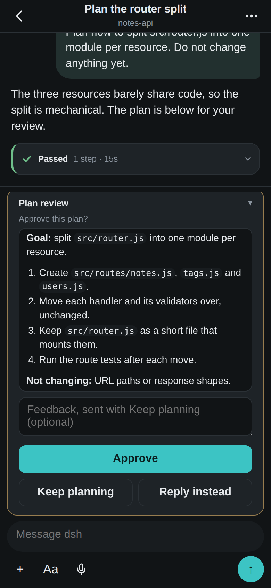
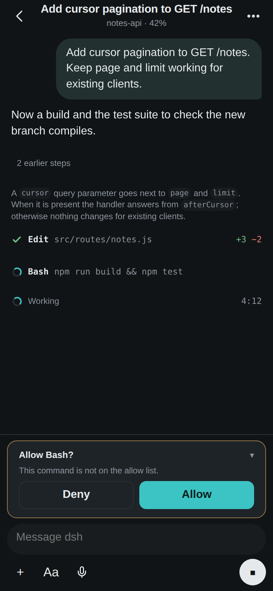
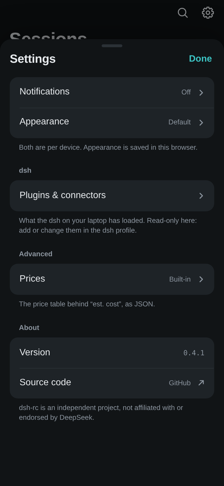
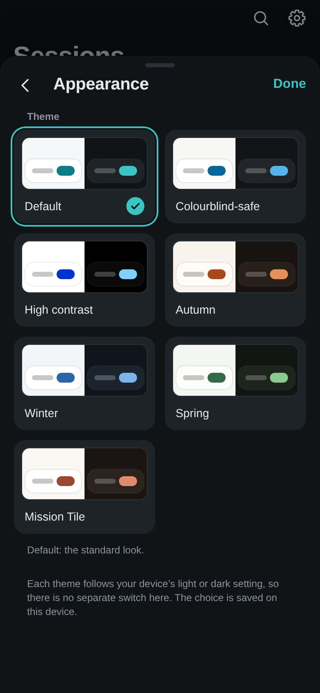

# dsh-rc

A phone-first remote control for a running `dsh web` server (compatible with DeepSeek Harness).
Independent project, not affiliated with or endorsed by DeepSeek.

Run dsh on your laptop, drive it from your phone: watch sessions work, answer approvals, steer or
stop a turn, and get a push notification when it needs you. Works with dsh 0.1 and with the newer
API that dsh 0.1.7 and 0.2 speak (see Compatibility).

**At a glance**
- Session list in attention order: Needs you, Running now, Unread, Today, Earlier. A live row
  for every active session shows the current step, a running clock, todo progress, context when
  it is nearly full, background jobs (stop them from the phone) and its subagent tree.
- Chat with streaming replies, tool rows you tap to expand, file edits as line diffs, and a
  compact review receipt at the end of each turn (files changed, commands run, passed or failed).
- Approval, question and plan-review cards above the composer, with the full command shown
  before Allow; the send button turns into stop while a turn runs, a message queues by default
  and can steer the running turn instead; edit or remove queued messages.
- Session details one tap away: model and route, context fill, tokens, estimated cost and session facts.
- Composer extras: slash commands, @-mention files, and a plus menu for photos and image files,
  saved prompt templates and the command list; dictation where the browser has speech
  recognition.
- Session menu: session details, switch model, rename, fork, export, and on dsh 0.2 set a goal or
  manage scheduled prompts; then Settings, and archive on its own, confirmed first.
- Settings, from the gear on the session list: notifications, appearance, plugins and connectors,
  prices under Advanced, the tunnel QR code while a tunnel runs, and About with the version.
- Web Push for approvals, questions, finished turns and errors.
- Seven themes under Settings > Appearance, each previewed as a light and dark swatch, saved per
  device and following light or dark: the default, a colourblind-safe one (blue, orange and
  crimson, no red against green), high contrast, autumn, winter and spring, and Mission Tile
  (warm paper, ink and tile red, in a serif).
- Reach it over Tailscale, or as its own front door with a passphrase login, HTTPS or a Cloudflare
  quick tunnel with a QR code.

No build step. `public/` is plain HTML, CSS and JS; `server/` is plain Node ESM (Node 22 or newer). Markdown uses
marked and DOMPurify, vendored in `public/vendor/` (their license headers are kept in the files).

## Screenshots

Made from the demo sessions described under "Regenerating the screenshots", never from a real
dsh. Every project, path and conversation in them is invented.

| | | | |
|:-:|:-:|:-:|:-:|
|  |  |  |  |
| The board | Running now, jobs and subagents open | Chat with the turn receipt | Edit as a line diff |
|  |  |  |  |
| Receipt opened to its activity | Session details and per-turn usage | Plan review | Approval while a turn runs |
|  |  | | |
| Settings | Appearance, one card per theme | | |

## Setup

```
npm install
npm start
```

`npm install` pulls the single runtime dependency (`web-push`). `npm start` runs
`node server/index.mjs`. `npm test` runs the Node test runner (`node --test`).

## How it is served

dsh refuses API calls from any other origin, so this page must share the origin of dsh web.
Either mount both on one name with Tailscale Serve, as here, or let dsh-rc's own proxy be the
front door (see "Access beyond Tailscale" below). With Tailscale Serve, mount the page at `/m`
beside dsh on port 443:

```
https://<machine>.<tailnet>.ts.net/    -> 127.0.0.1:3080  (dsh web)
https://<machine>.<tailnet>.ts.net/m/  -> 127.0.0.1:3081  (this page, node server/index.mjs)
```

1. Start dsh so it trusts your tailnet name:
   `dsh --profile <profile> --no-open --trusted-host <machine>.<tailnet>.ts.net`
2. Serve the page on loopback: `npm start` (or `node server/index.mjs`). It listens on
   127.0.0.1:3081 by default, and refuses any other bind address unless a passphrase is
   configured (see "Access beyond Tailscale" below). Override the port with `DSH_RC_PORT`.
3. Mount both on your tailnet name:
   `tailscale serve --bg 3080` (dsh web at `/`), then
   `tailscale serve --bg --set-path /m http://127.0.0.1:3081` (this page at `/m`)
4. Open `https://<machine>.<tailnet>.ts.net/m/` on your phone. Add it to the home screen for full screen.

`examples/` has user systemd units for both processes.

## Access beyond Tailscale

The server can also be the whole front door by itself. It serves the page and proxies `/api`
and the two event sockets to `$DSH_URL`, so nothing has to share dsh's origin through path
mounting. dsh itself stays on loopback in every setup below.

**Once, for every standalone setup: let dsh trust the proxy.** dsh answers 403 to any Host it
does not trust, and it keeps settings, credentials and a few host actions for loopback Hosts
only. The proxy therefore presents its own name, `dsh-rc.internal`, rather than pretending to be
loopback, and dsh must be told to trust it:

```
dsh --profile <profile> --no-open --trusted-host dsh-rc.internal
```

(`--trusted-host` repeats, so keep your tailnet name as well if you use both.) Change the name
with `--upstream-host` / `DSH_RC_UPSTREAM_HOST`; a loopback name is refused. The proxy also
refuses the settings and credentials methods itself. If dsh answers 403 anyway, the server log
says which flag is missing.

**A passphrase is required whenever anything beyond this machine can reach the server**: a
non-loopback `--host`, or `--tunnel` (cloudflared connects from loopback, so the bind address
alone would not catch it). Without one the server refuses to start. Set it once with

```
node server/index.mjs --set-passphrase
```

which prompts (without echo), stores a scrypt hash in the state dir and signs out every existing
login. `DSH_RC_PASSPHRASE` works too, but leaves the plaintext in the environment. Passphrases
shorter than 12 characters are refused. A configured passphrase also turns the login on for a
loopback-only server.

With no passphrase, a loopback server keeps working as before, but its proxy only answers
requests whose Host is loopback (`127.0.0.1`, `localhost`, `[::1]`) or listed with
`--trusted-host` / `DSH_RC_TRUSTED_HOSTS`. A reverse proxy or tunnel pointed at it by mistake
forwards its public Host and gets 403, and so does a DNS-rebinding web page. Only list names on a
private network there.

### Plain LAN

```
node server/index.mjs --host 0.0.0.0
```

Open `http://<lan-address>:3081/` from a device on the same network. This is plain HTTP, so
anyone on the network can read the passphrase and session cookie in transit, and Web Push is
unavailable (browsers require HTTPS). Use it on a network you trust, or add HTTPS below.

### Cloudflare quick tunnel

```
node server/index.mjs --tunnel
```

This spawns `cloudflared tunnel --no-autoupdate --url http://127.0.0.1:3081` and prints the
`https://<random>.trycloudflare.com` URL it gets. cloudflared must already be on `PATH`; dsh-rc
never downloads it, and `--no-autoupdate` stops cloudflared updating itself. Install it from
[Cloudflare's downloads page](https://developers.cloudflare.com/cloudflare-one/connections/connect-networks/downloads/).

A quick tunnel has no access control of its own, so the passphrase is the only thing between
anyone who learns the URL and a shell as you. Pick a long one. The URL changes on every start,
so it is not something to bookmark or add to a home screen. The URL is also printed as a QR code
in the terminal, and Settings (the gear on the session list) has an "Open on your phone" row that
shows the same code, with Copy and, where the browser has a share sheet, Share, so a phone can scan
it instead of typing the address. The code holds only the URL; the phone still has to log in.
The encoder is a small one in `public/qr.js`, with no dependency.

### Named Cloudflare tunnel with Access (the durable setup)

Create a named tunnel on a domain you control and run it yourself, outside dsh-rc, pointed at
`http://127.0.0.1:3081`. Put the hostname behind a
[Cloudflare Access](https://developers.cloudflare.com/cloudflare-one/policies/access/) policy
that admits only you, so strangers never reach the page. Start dsh-rc with a passphrase anyway;
it is a second lock, and the no-passphrase Host check would refuse the tunnel's hostname.

### ZeroTier, NetBird or WireGuard

These put the machine on a private network as Tailscale does, but without Serve in front. Bind
dsh-rc to the machine's address on that network with a passphrase, and open
`http://<vpn-address>:3081/`:

```
node server/index.mjs --host <vpn-address>
```

Traffic is encrypted by the VPN, but the browser still sees plain HTTP, so Web Push needs HTTPS
as below.

### HTTPS

- **Your own certificate.** `--cert <file> --key <file>` (or `DSH_RC_CERT`, `DSH_RC_KEY`) serves
  everything over HTTPS directly, and marks the session cookie `Secure`. Both are required.
- **Behind Caddy** (or another reverse proxy). Keep dsh-rc on loopback with a passphrase and let
  Caddy terminate TLS, for example `<name> { reverse_proxy 127.0.0.1:3081 }`. Caddy's automatic
  certificates need a real domain name pointing at the machine. Caddy passes the browser's Host
  through, which the Origin check expects.

**Never expose dsh itself** (port 3080), whether through a tunnel, a LAN bind or a reverse proxy.
It has no authentication, and dsh-rc exists so that it never has to.

## Notifications

The server also watches dsh's event feeds (dsh 0.1: `/api/events.mux` and `/api/events.host`;
dsh 0.2: one `/api/remote.mux` socket; read-only, with capped reconnect backoff) and sends a Web Push notification with VAPID when:

- an approval is requested (title "Approval needed", with the tool name and reason),
- a question is waiting (title "Question waiting"),
- a turn finishes (title "Turn finished"),
- an agent or stream error arrives (title "Error", with the message).

Subagent sessions are ignored, the session title is included when known, repeats with the same
tag are debounced for 5 seconds, and subscriptions that answer 404 or 410 are removed. Tapping a
notification focuses an open dsh-rc window and opens that session, or opens `./index.html#s=<id>`.

In the app, tap the gear on the session list (or **Settings** in a session's ⋯ menu) and pick
**Notifications**. Turn on **Allow notifications** there: it asks for the permission from that tap
(browsers, iOS especially, only grant it from a user gesture). If the browser refuses or the
subscription fails, the switch goes back to off and the page says why. The page also shows the
permission the browser holds, what sends a push, the Add to Home Screen steps when it is open in an
iOS Safari tab, and, while on, **Send a test**, which notifies every subscribed device.

iOS notes: notifications only work in a web app added to the Home Screen (Share, then Add to
Home Screen), on iOS 16.4 or newer. The origin must be HTTPS, which the Tailscale Serve mount
already provides. In a plain Safari tab, add it to the Home Screen first and open it from there.

State lives outside the repo, in `$DSH_RC_STATE_DIR` (default `$XDG_STATE_HOME/dsh-rc`, falling
back to `~/.local/state/dsh-rc`). `vapid.json` (generated on first run) and `subscriptions.json`
are written as 0600 files in a 0700 directory.

Environment variables:

| Variable | Default | Meaning |
| --- | --- | --- |
| `DSH_RC_PORT` | `3081` | Port for the page, push API and proxy |
| `DSH_RC_HOST` | `127.0.0.1` | Bind address; anything but loopback needs a passphrase |
| `DSH_RC_STATE_DIR` | `$XDG_STATE_HOME/dsh-rc` or `~/.local/state/dsh-rc` | Where `vapid.json`, `subscriptions.json`, `passphrase.json` and `session-secret` live |
| `DSH_RC_VAPID_SUBJECT` | `https://github.com/Matthew3957/dsh-rc` (Apple rejects `localhost` mailto subjects; use your own `mailto:` or `https:` URL) | VAPID subject sent with each push |
| `DSH_URL` | `http://127.0.0.1:3080` | dsh web base URL: its event sockets are watched and `/api` is proxied to it |
| `DSH_TOKEN` | none | dsh 0.1.7 and later only: the launch token dsh printed at start (or the whole `?token=` URL) |
| `DSH_TOKEN_FILE` | none | dsh 0.1.7 and later only: a file holding that token, read again on every exchange |
| `DSH_RC_UPSTREAM_HOST` | `dsh-rc.internal` | Host the proxy presents to dsh; start dsh with `--trusted-host` for it |
| `DSH_RC_TRUSTED_HOSTS` | none | Comma-separated extra Host names the proxy accepts when there is no passphrase |
| `DSH_RC_PASSPHRASE` | none | Login passphrase, 12 characters or more (hashed in memory; `--set-passphrase` avoids keeping the plaintext around) |
| `DSH_RC_TUNNEL` | off | `1` or `true` starts a Cloudflare quick tunnel; requires a passphrase |
| `DSH_RC_CERT`, `DSH_RC_KEY` | none | Certificate and key files to serve HTTPS directly |
| `DSH_RC_CLAUDE_CONFIG_DIRS` | none (feature off) | Comma-separated Claude Code config dirs whose transcripts Running now may show for external Claude subagents (see Running now) |

Flags: `--host`, `--port`, `--dsh-url`, `--upstream-host`, `--trusted-host` (repeatable),
`--dsh-token-file`, `--tunnel`, `--cert`, `--key`, `--claude-config-dir` (repeatable), and `--set-passphrase`, which stores a hashed passphrase (from
`DSH_RC_PASSPHRASE`, or a prompt) and exits. Flags win over environment variables. `--help`
lists them.

Push API (same origin, under `/m/`): `GET ./push/key`, `POST ./push/subscribe`,
`POST ./push/unsubscribe`, `POST ./push/test`. JSON bodies are capped at 16 KB and at most 20
subscriptions are stored; endpoints must be HTTPS.

## Security

dsh has no authentication. Anyone who can reach it can run commands as your user. Keep dsh itself
on loopback, or tailnet-only through Tailscale Serve (not Funnel), and never point a tunnel, a LAN
bind or a reverse proxy at it directly. dsh blocks settings and credential changes from
non-loopback hosts. This page does not edit settings or credentials, but it can do anything a
dsh session can: send prompts, run slash commands, approve tools, switch models, rename, fork
and export sessions, and archive them (which dsh cannot undo).

When dsh-rc is the front door, it adds:

- **A passphrase login**, required for any non-loopback bind and for `--tunnel`, optional on a
  loopback-only server. Sessions are HMAC-signed cookies (HttpOnly, SameSite=Strict, `Secure`
  over HTTPS or a tunnel) that last 30 days; `--set-passphrase` revokes all of them. The
  passphrase is stored as a scrypt hash. Login attempts are limited to 10 a minute across all
  clients, since behind a tunnel every client looks like loopback. Without a session, only the
  login page, the manifest and the icons are served.
- **An Origin check** on every write and every event socket: a request whose Origin does not
  match its Host is refused, as is `Sec-Fetch-Site: cross-site`. Other web pages cannot drive
  dsh through the proxy.
- **A Host check without a passphrase**: the proxy only answers loopback or `--trusted-host`
  names (see above).
- **Read-only transcript views.** With `--claude-config-dir`, `/claude/*` answers GET and HEAD
  only, behind the same login and Host/Origin checks as `/api`, with `Cache-Control: no-store`.
  The page never names a file: it gets opaque run ids, each tied to a UUID-named transcript
  directly under a configured dir's `projects/`, and symlinks there are not followed.
- **No privileged Host.** The proxy presents `dsh-rc.internal`, never a loopback name, so dsh's
  loopback-only settings and credentials methods stay out of reach. The proxy refuses them as
  well, and drops its own session cookie before forwarding.

With the Tailscale Serve mount described above, `/api` goes straight to dsh and none of this
applies to it; the tailnet is the boundary there.

## Protocol notes

- RPC: `POST /api/<method>` with `{type:"client-request", rpcId, method, payload}`.
  Typert methods such as `commands/execute` take `payload: {args: {...}}`.
- Events: WebSockets `/api/events.mux` (all sessions) and `/api/events.host` (status). Receive only.
- Approvals and questions are answered with `POST /api/respond` (a client-response).
- Slash commands go through `commands/execute`, not `session.prompt`.
- Typing `@` in the composer lists files and folders of the session's working directory
  (`fileReferences/list`, payload `args: {agentId, query}`) and inserts the path, `@"..."` when it
  has spaces. Tapping a folder keeps the list open one level down.
- The above is the older dsh API (0.1.6 and earlier). The newer one, from 0.1.7 on ("dsh 0.2" below), differs on every point (namespaced methods, one `/api/remote.mux`
  socket, a cookie); `public/dsh02.js` maps it onto the same shapes. See Compatibility below.

## Compatibility

| dsh | Status |
| --- | --- |
| 0.1.1-rc.2 | Supported (older API), what everything here was first built against. |
| 0.1.7-rc.2 | Supported (newer API, same as 0.2): the 0.1 line switched protocols at 0.1.7. |
| 0.2.0-rc.2 | Supported for the core (npm's `latest` tag at the time of writing): session list, chat streaming, prompts, approvals, questions, queue, stop, model, rename, fork, archive, new session, slash commands, push notifications, and the read-only plugins and connectors screen. Gaps are listed below. |

The newer API arrived in 0.1.7, not 0.2: everything said about "dsh 0.2" below applies to 0.1.7 too.
One page and one server speak both. The page asks `host.describe` (dsh 0.1) first; when that is a
404 it asks `session/canOpenWorkspacePath` (dsh 0.2) and, if that answers, switches to the 0.2
transport. The push watcher makes the same choice on every (re)connect, so a dsh restarted as the
other version is picked up without restarting dsh-rc.

### Running dsh-rc against dsh 0.2

dsh 0.2 answers 401 to everything until it has a signed cookie. dsh prints a launch URL at start
(`http://127.0.0.1:<port>/?token=...`); give dsh-rc that token:

    DSH_TOKEN=<token> node server/index.mjs
    # or keep it in a file a supervisor rewrites when dsh restarts
    node server/index.mjs --dsh-token-file <file>

dsh-rc exchanges it for dsh's cookie (one per Host it presents, since dsh binds the cookie to it)
and adds that cookie to every proxied call and socket. The browser never sees dsh's cookie, only
dsh-rc's own login. The page therefore has to be served by dsh-rc (the front-door setup); a
Tailscale Serve mount straight to dsh has nothing to hold the cookie and shows "dsh wants its
launch token". Start dsh with `--trusted-host` for the name dsh-rc presents, as before. The token
is as powerful as dsh's own login, so keep it out of the command line (use the environment or a
file with mode 0600).

### How the 0.2 port works

Everything below comes from the generated `typert.remote-client.d.ts` contracts in
`dsh-api-session-controller`, `dsh-api-workspace-controller`, `dsh-api-job-controller`,
`dsh-agent-preset-registry`, `dsh-commands`, `dsh-user-questions`, `dsh-subagent`, `dsh-goal` and
`dsh-host-plugin-inventory`, the framing in `dsh-api-gateway`'s stream protocol, and the
`approval/request` and `user-questions/request` events in `dsh-user-approval` and
`dsh-user-questions`, checked against a running 0.2.0-rc.2.

- **Calls.** `POST /api/<namespace>/<method>`, `payload: {args}`, every parameter under its declared
  name (`session/list` wants `{_request: {}}`, `session/prompt` wants `{request: {...}}`).
  `public/dsh02.js` maps the 0.1 method names the page uses onto these, and back again.
- **Live data.** One WebSocket, `/api/remote.mux`, carrying logical streams: `$events` (session
  status and errors, and the approval and question requests), `session/control` (every session's
  projections: title, queue, usage), `workspace/follow` (the archive set) and, for the open session,
  `session/follow` (snapshot, durable events, live assistant chunks). Each item is converted into
  the 0.1 frame the page already renders, so the chat, session details and dashboard code is shared.
- **Goals** (`dsh-goal`). The `goal` projection arrives on `session/control` like any other and
  drives the goal line under the header; `goals/get` adds whether continuation is armed, and
  `goals/create`, `edit`, `pause`, `resume`, `complete` and `clear` change it, each carrying the
  goal's `{id, revision}` so a stale view is refused. The older API has no goals: the line never
  shows and the menu entry is not offered.
- **Approvals and questions** are not calls but pending requests dsh holds open until some client
  answers with `POST /api/$events/result`. Like a second browser tab, dsh-rc's watcher sees them and
  never answers. dsh does not echo a cancel to the client that answered, so the page clears the card itself.
- **Plugins and connectors.** `pluginInventory/list` exists on both APIs, but 0.2's snapshot (in
  `dsh-host-plugin-inventory`) adds localized display metadata and each agent preset's flattened
  composition. `fromPluginInventory` in `public/dsh02.js` resolves that, and the sheet lists failed
  entries first, then presets (a broken or failing composition first), then every plugin.
  `dsh-plugin-manager` does offer per-entry `setPluginEnabled`, but the sheet stays read-only: the
  proxy refuses the whole `pluginManager` namespace, so a phone cannot change the profile.
- **Tool cards.** 0.1 attached each tool's presentation view to its events. 0.2 sends none:
  `tool/call` carries the raw arguments and `tool/result` the result text plus the tool's private
  `meta` (dsh-session's event map). Like dsh's own web client, `public/dsh02.js` rebuilds the 0.1
  views from those. `write`, `edit` and `str_replace_editor` become diff cards (the applied hunks
  from `meta` once settled); foreground `bash` and `pwsh` calls become commands whose exit code or
  signal comes from the `[exit code: N]` marker dsh-shell appends (the persistent shell's
  `[Command finished with exit code N]`); a `read` is a line-numbered file window (its path, the
  line range and the language hint); a `grep` a per-file match list and a `glob` a path list; a
  `web_search` its citeable sources and answer, a `web_fetch` its URL and HTTP status; and a
  `todo_write` the checklist with a mark per item. Each carries a one-line summary — file and line
  range, pattern and match count, query and source count, URL and status, todo progress — and
  opens to the full result. A malformed or missing `meta` falls back to the generic row, and since
  0.1 already sends these views, the same cards render there. The diff rows, receipt and verdict work as they do on 0.1.

**Background jobs.** 0.2 has no host-wide jobs feed, so `public/dsh02.js` opens one `job/list`
stream per listed session (the first 64, since the list is activity-ordered; its own jobs plus
every unowned job), maps each whole-set `rows` frame onto the page's `session/jobs` frame, and
keeps the streams across reconnects; a stream failure clears only that session. Tapping a job row
opens a `job/follow` stream for its retained output, and a running job carries a two-tap stop that
calls `job/kill`. There is no `job/kill` in the older API, so the stop control is absent there.

**Subagent trees and expired questions.** `subagent.list` answers from a session's
`subagentCatalog` projection and probes a child whose own catalog the control feed omits, so the
page's recursion reaches grandchildren. A tree is read again as soon as it changes (a subagent
added, a child starting or settling, the parent's catalog growing), so a parent whose turn ended
while a background child works stays in Running now until the child settles. The `userQuestions`
projection is mirrored as question frames: a `continued` row (the timed wait ran out and the agent
moved on) shows as an expired card that says so and is still answered through
`userQuestions/answer`; Dismiss declines it.

### Scheduled prompts (dsh 0.2 with the schedule plugin)

The session menu gets a **Scheduled prompts** entry when dsh has its optional schedule plugin
switched on (Automation tasks in dsh's Plugins page, the `dsh-experimental-schedule-bundle`).
dsh ships it off; without it every `schedule/*` call is a 404, dsh-rc notices once per connection
and shows nothing. The older API has no schedules and never sees the entry.

- **List and open** this session's tasks (name, how often, next run, a glyph for scheduled,
  overdue or finished) from `schedule/catalog`; the sheet refreshes on dsh's `schedule/changed`.
- **Edit** the name, the prompt or the timing with `schedule/update`, which is compare-and-update:
  an edit made elsewhere since you opened the task answers a conflict instead of being overwritten.
  Timing is one of in N minutes/hours/days (sent as an absolute time, which is all an update accepts
  for a one-shot), at a date and time, every N, daily at, or on chosen weekdays at, in the phone's zone.
- **Delete** with `schedule/delete`, armed by a first tap (no `confirm()`, which a Home Screen app lacks).
- **Create** is different: dsh's remote API has no create call, only the agent's `schedule_create`
  tool. The form therefore sends a message asking the agent to call it with exactly the chosen
  arguments. That is one short model turn, and the task appears in the list once the agent has made it.
- **Not here:** pause (dsh has none; a finished one-shot stays listed as finished), cron rules (shown,
  not editable), delivery history (`schedule/history`) and turning the plugin on, which is a
  `pluginManager` call the proxy refuses.

### Not ported yet (dsh 0.2)

- **`str_replace_editor`** shows its diff while it runs and a plain row once settled, as in dsh's
  web client, so it is not counted in the turn receipt. A command whose output was spilled to a
  file has no exit code to show.
- **Session search** answers as dsh does: on a deployment with the session-query index off it fails.
- **File uploads**, terminals and settings are not touched (refused by the proxy, as before).

Checked in headless Chromium with real DeepSeek turns against 0.1.1-rc.2, 0.1.7-rc.2 and
0.2.0-rc.2: streaming, reasoning blocks, tool calls and results, diffs and turn receipts,
background jobs (shown and stopped), session details, goals, and an approval card answered from
the page. Images in the live stream are still read from the contracts only. The adapter is also
covered in Node (`test/dsh02.test.mjs`).

## Smoke test

`scripts/smoke.mjs` guards the RPC surface the page depends on. It extracts every
`rpc(...)` or `remote(...)` method name from `public/app.js`, detects which dsh API is
running, then calls one harmless read method per namespace. A method that no longer exists
answers HTTP 404 and the script exits non-zero:

```
DSH_URL=http://127.0.0.1:3080 node scripts/smoke.mjs   # or: npm run smoke
```

Against dsh 0.1.7 and later it first exchanges the launch token for dsh's cookie, the same
way the server does, so the same two sources work:

```
DSH_TOKEN=<token> node scripts/smoke.mjs
DSH_TOKEN_FILE=<file> node scripts/smoke.mjs
```

`--token` and `--token-file` set the same values; either accepts a bare token or the whole
`?token=` URL dsh printed. With no token the older API still works, and the newer one
answers 401 and the script says so. On the newer API it probes the 0.2 endpoints
`public/dsh02.js` maps the page's calls onto: one harmless unary read per namespace
(`session/list`, `directoryPicker/list`, ...) and one harmless read of each mux feed the
adapter opens (`$events`, `session/control`, `workspace/follow`, ...). An unknown endpoint
answers HTTP 404, an unknown feed `gateway/invocation-unavailable`, and either fails the
script.

The only requests it can send are the read methods on its allowlist; it never starts,
prompts, steers or changes a session. The session-changing methods the page calls are
listed in the output as not called, so a rename there still takes a live phone to notice.

## Reviewing the work

- **Diffs.** A write or edit row shows `+added −removed` and opens as a line diff, with long
  unchanged stretches folded. It draws the hunk dsh reports once the call has finished (the
  change as applied) and the intended change while it runs. dsh sends hunks without line
  numbers, so none are shown, and a new file or an overwrite reads as all additions.
- **Turn receipt.** A completed turn ends with one compact row. Tap it to review its files,
  commands and activity; each tool row opens its detail or diff. The verdict glyph and word are
  **failed** when the turn errored or was blocked, or when its last command exited non-zero,
  **stopped** when it was interrupted or hit the output limit, and **passed** otherwise. Only the
  last command decides, so a test that failed and then passed within the turn reads as passed. A
  failed receipt opens itself. When the loaded history starts mid-turn the receipt says so.
- **Plan review.** When plan mode presents a plan, a compact card above the composer shows its
  goal and first two steps. **Review plan** opens the whole plan in a sheet with **Approve**,
  **Keep planning** (optional feedback goes back to the model) and **Reply instead** (closes the
  review, stays in plan mode and waits for your message). Closing the sheet leaves the card in
  place. The push notification reads "Plan ready for review".

## Estimated cost

Session details shows the estimated cost. dsh reports tokens and never dollars, so the page
multiplies the reported buckets by a price table shipped in `public/prices.js`. That table is a
transcription of the vendors' published rates for the models this dsh routes to, in USD per million
tokens. Prices change, so treat the numbers as a snapshot and override them when they drift.

Two rules keep the figure from being worse than useless:

- Model ids match by longest prefix, so a re-priced member of a family never inherits the family
  rate (Claude Opus 5.5 and Opus 5 differ).
- A model with no matching row reads `cost n/a` rather than a guess. Local models and free tiers
  have no row at all.

Every amount is labeled `est.` and ignores batch discounts, long-context tiers, data-residency
multipliers, and DeepSeek's peak/off-peak split (the table holds the peak rate, so it is an upper
bound).

To override a price, open Settings (the gear on the session list, or **Settings** in a session's ⋯
menu) and tap **Prices** under Advanced. The field takes JSON keyed by
model-id prefix, each mapping `input`, `output`, `cacheRead` and `cacheWrite`; blank clears it.
The longest prefix wins and an override beats the shipped table. It is saved in this browser's
`localStorage`, so it is per device.

## Session list

The main screen is one board in the order attention deserves: **Needs you**, **Running now**,
**Unread**, then **Today** and **Earlier** (Yesterday, Previous 7 days, Older). Each session
appears once. The large "Sessions" title scrolls away into the compact title in the bar; the bar
has search and a gear for Settings (see below). Search opens a field in the bar with Cancel, hides the
board and searches dsh; Cancel puts the board back where it was. The bottom bar holds the one
primary action, **New session**. If the connection to dsh drops, a "Reconnecting…" banner sits
under the top bar until it is back; the list stays readable meanwhile.

There is no filter control: the sections are the filter. **Needs you** lists each session waiting
on an approval or a question, with the command or question in one mono line. Tapping the row opens
the session; approving happens there, never in the list. **Unread** is for finished sessions you
have not read yet, with the filled dot; a failure says "Failed" in red there and in the date
sections, where it stays rather than competing with a live question. The status glyphs are one
set, used for sessions, tool calls, background jobs and subagents, and drawn the same way in every
theme, so no state relies on colour alone: a hollow ring for idle, a spinner for working, an amber
disc with `!` for an approval and with `?` for a question, a filled dot for unread, a tick for
done, a cross for failed, a triangle while stopping and a square once stopped.

## Settings and the session menu

There are two menus, and they do not overlap.

**Settings** is app-wide, from the gear on the session list (or **Settings** in a session's ⋯
menu). It is one page of grouped rows, each with its value: **Notifications** (on, off or not
supported), **Appearance** (the theme), **Plugins & connectors** (read-only), **Open on your
phone** under This device while a `--tunnel` runs, **Prices** under Advanced, and **About** with
the version of the page, a link to the source and, where dsh-rc is mounted beside dsh web, **Open
full dsh web UI**. Each row opens its own page inside the same sheet, with Back.

**Appearance** shows the seven themes as cards in two columns. Each card is a split swatch, the
light scheme on the left and the dark on the right, with the theme's page, card and accent colours,
and its name; the current one has a ring and a tick. A tap applies and saves it on this device.
There is no light or dark switch: every theme follows the device's setting.

The **session menu** (⋯ in a session) only acts on that session: Session details, Model, Goal and
Scheduled prompts where dsh has them, Rename, Fork and Export log; then Settings; then Archive, on
its own and in red, which asks first and says it cannot be undone. Commands are in the composer's +
menu (and the `/` list), and Refresh is in Session details.

## Running now

**Running now** is a section of the board, with a live row for every active session, meaning a
session with a turn in flight, a live background job, or a running subagent. A session waiting on
you is in Needs you instead, so nothing appears twice. Each row carries:

- **the title and a running clock** at the trailing edge. The clock is the current turn, or the
  oldest live job when no turn runs, written as `4:12` or `1:04:12`; it ticks without moving the
  row.
- **one line of current work**: the in-progress todo, the running job's label, or the subagent.
- **todo progress** from the `todos` projection: a 4 px bar with "2 of 5" only when dsh reports
  todos. Context from `contextPressure` appears as a small chip only from 80%, amber from 85 and
  red from 95.
- **background jobs** from the `session/jobs` mux frame: kind, label, state and elapsed time for
  each `JobView`. On dsh 0.2 the same rows arrive from one `job/list` stream per listed session; a
  tap on a job row opens its retained output (`job/follow`), and a running job carries a two-tap
  **Stop** that calls `job/kill` (the older API has no kill, so there is no stop there).
- **the subagent tree** from `subagent.list`, one direct-child catalog per parent, with each
  child's `subagentTiming` projection giving its active or settled time.

A footer such as "1 job · 2 subagents" expands those rows under the live row; a row with neither
has no footer and is shorter. Everything there is read-only except the 0.2 stop. Tapping the
title opens that session; tapping the footer expands the jobs and subagent tree, and tapping a
0.2 job row expands its output. The section follows the projection and jobs pushes, refetches a
subagent catalog only when it is stale, and stops while a chat is open.

### External Claude Code subagents

dsh's `subagent_claude_opus` and `subagent_claude_sonnet` tools run the real Claude Code CLI as
one-shot external tasks. dsh only sees them start and finish, so their rows in the subagent tree
say `external` and nothing more. Claude Code writes its own transcript as it works, and dsh-rc
can read it and show the last few tool calls and lines of text under the run's row
(`Bash: npm test`, `Read: public/app.js`, `Grep: foo in server`), updating every few seconds
while the row is open. A transcript written in the last five minutes also marks the run as
working: its glyph keeps spinning and its parent stays in Running now after the parent's turn ends,
whether or not the row is expanded.

Point dsh-rc at the same config dir the provider uses. If your dsh profile sets
`CLAUDE_CONFIG_DIR` in that provider's `env` block, pass that directory; if it sets none, Claude
Code uses `~/.claude`, so pass its absolute path:

    node server/index.mjs --claude-config-dir /path/to/claude-config
    # or, for several providers with their own dirs:
    DSH_RC_CLAUDE_CONFIG_DIRS=/path/to/one,/path/to/two node server/index.mjs

`--claude-config-dir` repeats. Paths must be absolute. Without one, nothing is read and the rows
look as before.

How it works: Claude Code appends `<config dir>/projects/<the run's cwd, encoded>/<session>.jsonl`.
The page asks `GET ./claude/runs?cwd=<parent session cwd>&since=<run start>` and gets the
transcripts in that folder whose first prompt landed within a few seconds of the run's
`createdAt` in the parent's `subagentCatalog`, nearest first, as opaque ids. dsh does not say
which tool ran an external run, so every one is looked up (the eight most recent per session,
while the session is in Running now, expanded or not). Each claims one transcript, preferring the
one whose prompt contains the run's label, so concurrent runs do not share a feed. It then reads
`GET ./claude/runs/<id>?offset=<n>` (every 3 seconds under an expanded row, every 6 under a
folded one), which answers only the complete lines appended since the last read (a half-written
last line waits for the next poll), already reduced on the server to short summaries: no
thinking, no tool results beyond whether they failed, no full tool inputs. Interactive Claude Code sessions in the same folder are skipped.
Codex and Gemini runs have no such transcript, so they never match: a run with no match shows
nothing and never keeps a row in Running now.

## Regenerating the screenshots

`scripts/demo-dsh.mjs` is a deterministic mock of the dsh web API. It replays hand-written
sessions from `scripts/demo-fixtures.mjs` (projects under `/work/demo`, nothing real) and answers
only the reads the page makes. To click through the demo yourself:

```
node scripts/demo-dsh.mjs --port 3180
node server/index.mjs --dsh-url http://127.0.0.1:3180
```

`scripts/screenshots.mjs` starts both, opens the page in a headless Chromium at 390x844 (2x) with
the clock pinned, and writes `docs/screenshots/*.png`. A browser is not a dependency of this repo;
point the script at one you have:

```
PLAYWRIGHT_CORE=/path/to/node_modules/playwright-core \
CHROMIUM_PATH=/path/to/chrome-or-headless-shell \
npm run screenshots
```

The output is byte-identical between runs. Edit the fixtures, rerun, and commit the new images.
Keep each image under around 250 KB, and never point this at a real instance.

The committed set is the default theme in the dark scheme. To review another theme or the light scheme, add `--scheme light|dark` and `--theme <id>` (one of
the ids in `public/theme.js`), and `--width 320` or `--width 430` for another phone width; write
somewhere outside the repo with `--out`. Those images are for review, not for committing.

Two checks run in the same harness. `--audit` taps every control on screen in each scene (and in
a few extra states: the session menu, New session, search, the plus menu, Queue/Steer, and
Notifications) and fails any whose hit box is under 44 by 44, any control without an accessible
name, and any console error. `--reduced-motion` renders with Reduce Motion on and fails if
anything could still move, or if a fade is slower than 120 ms or the working glyph faster than
3 s. Both exit non-zero on a failure, and neither writes into `docs/screenshots` unless `--out`
is given. If Chromium aborts at launch inside a sandbox that refuses sockets, point
`CHROMIUM_PATH` at Playwright's `chrome-headless-shell` instead.

## Roadmap

Next, in priority order:

1. **Toggle and add connectors from the phone** (#70): switch existing MCP connectors and subagent
   providers on or off first; adding new ones needs a safety design, since a local connector is a
   command on the laptop.
2. **Finish the newer-API port**: the gaps listed under Compatibility, and dropping the older API once
   dsh 0.2.0 is final.

## License

MIT, see `LICENSE`.
